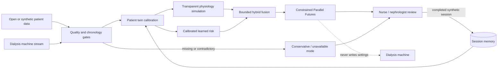

# NADI-HD system diagram

The dashed edge is a prohibited boundary, not a control connection. NADI-HD never writes to a dialysis
machine. Every risk channel remains separately testable, and disagreement expands uncertainty.
